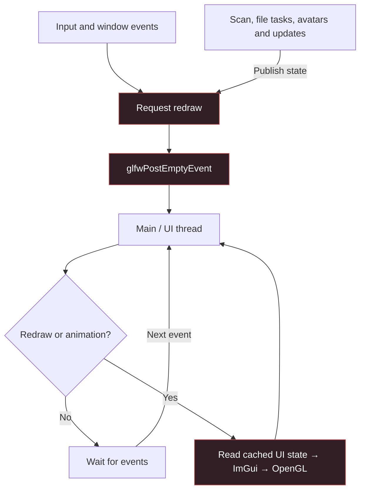

<p align="center">
  
</p>

<h1 align="center">Dota 2 Config Manager</h1>

<p align="center">Your Dota 2 setup, on another Steam account.</p>

<p align="center">
  
</p>

<p align="center">
  <a href="https://github.com/OutTuna/Dota2CFGChanger/actions/workflows/build.yaml"></a>
  <a href="https://github.com/OutTuna/Dota2CFGChanger/releases/latest"></a>
  <a href="#download"></a>
  <a href="#features"></a>
  <a href="LICENSE"></a>
</p>

<p align="center">
  <a href="#quick-start">Quick start</a> ·
  <a href="#architecture">Architecture</a> ·
  <a href="#build-from-source">Build</a> ·
  <a href="https://github.com/OutTuna/Dota2CFGChanger/issues">Issues</a> ·
  <a href="docs/TODO.md">Roadmap</a> ·
  <a href="#русский">Русский</a>
</p>

Copy your Dota 2 configuration between Steam accounts, with verified backups and a restore history. Choose the source, choose the destination, and confirm the transfer. No Steam login or API key required.

## Features

| Transfer | Recover | Keep it lightweight |
| --- | --- | --- |
| Find Steam accounts and copy their Dota 2 config. | Keep the last **5 verified backups per account** and restore from the app. | Wait for events at rest; scan, copy and load avatars in the background. |

- **Three languages:** English, Russian and Ukrainian. English is the default.
- **Five built-in themes:** Dark by default, with a palette editor for Crimson.
- **Standalone releases:** one Windows executable or Linux AppImage, with themes and translations embedded.
- **Account previews:** cached names and avatars from public Steam Community profiles. Failed lookups still leave the account ID visible.
- **Updates through GitHub HTTPS:** check file size and SHA-256, replace the application through a helper, then confirm the new window has started. SHA-256 is not an independent author signature; see the [update trust model](docs/UPDATE_SECURITY.md).
- **Transfer preview:** inspect added, replaced, unchanged and removed paths before confirming. Identical configurations are not rewritten.
- **Large account lists:** filter by name or ID; right-click an account to open its folder.

## Download

| Platform | Standalone download | Run |
| --- | --- | --- |
| Windows x64 | [DotaManager.exe](https://github.com/OutTuna/Dota2CFGChanger/releases/latest/download/DotaManager.exe) | Open the executable. |
| Linux x86_64 | [Dota2_CFG_Changer-x86_64.AppImage](https://github.com/OutTuna/Dota2CFGChanger/releases/latest/download/Dota2_CFG_Changer-x86_64.AppImage) | Make it executable, then launch it. |

```sh
chmod +x Dota2_CFG_Changer-x86_64.AppImage
./Dota2_CFG_Changer-x86_64.AppImage
```

Both platforms need a working OpenGL driver. On Linux, the folder picker uses `zenity` or `kdialog`. macOS is not supported.

<details>
<summary>Linux fonts and package recipes</summary>

The interface automatically uses installed JetBrains Mono, including NL and Nerd Font variants, and falls back to DejaVu, Liberation or Noto. It searches both user and system font folders. JetBrains Mono is optional; there is no font selector in the app.

Package recipes have their own branches and installation instructions:

| System | Recipe | Installation guide |
| --- | --- | --- |
| Arch Linux | [aur-packaging](https://github.com/OutTuna/Dota2CFGChanger/tree/aur-packaging) | [Build and install with makepkg](https://github.com/OutTuna/Dota2CFGChanger/blob/aur-packaging/README.md#arch-linux-installation) |
| NixOS / Nix | [nix-packaging](https://github.com/OutTuna/Dota2CFGChanger/tree/nix-packaging) | [Run or install with Nix](https://github.com/OutTuna/Dota2CFGChanger/blob/nix-packaging/README.md#nixos-installation) |

Package-managed builds use their package manager for application updates. Follow the README on the corresponding branch for the supported installation method.

</details>

## Quick start

1. Close Dota 2 and Steam before copying.
2. Check the source and destination folders. The app tries to find Steam's `userdata` directory, including Linux Flatpak installations; you can choose another folder manually.
3. Click **Scan folders**.
4. Select the source account on the left and the destination account on the right.
5. Click **Copy config**, check the selected accounts, and confirm.

Use the same `userdata` root for both lists, or choose a saved copy as the source. Each root should follow Steam's layout:

```text
userdata/
└── <account_id>/
    └── 570/
```

> [!IMPORTANT]
> The selected destination account's **entire `570` directory is replaced**. An existing config is backed up first. If that backup fails, replacement does not start.

### Backups and restore

Select a destination account and click **Backups** at the bottom of the window. Choose a saved copy and confirm restoration. Restoring also backs up the current config first.

Backups include the account ID and UTC date, and are verified with file hashes. The app retains the last **5 backups per account**. A destination with no existing config has nothing to back up on the first copy.

New files are prepared before replacing the destination. If replacement fails, the app attempts rollback; files needed for recovery are preserved if rollback cannot finish. Resolve an interrupted transaction before retrying, and keep a separate copy of anything you need beyond the five-backup history.

For interrupted transfers and stale account locks, follow the [recovery guide](docs/RECOVERY.md). Free-space checks are advisory; filesystem errors still stop the operation and trigger rollback.

Selective transfer is deferred until configuration dependencies can be verified. Full replacement remains the supported operation.

### Updates

Versioned standalone builds check for updates at startup. You can also use **Check for updates** at the bottom of the window.

1. Choose **Download and update** to start downloading.
2. The app verifies the file size and SHA-256.
3. A helper waits for the app to close, replaces its executable at the existing path, and restarts it.
4. The previous executable is kept until the new window confirms startup. Replacement or startup failure triggers recovery.

The updater trusts GitHub and HTTPS certificate verification. Hashes from the same release do not protect against compromise of that publishing authority. See [security limits and signing requirements](docs/UPDATE_SECURITY.md).

Use **Open release** if a verified download is unavailable. If the application folder is not writable, replace the file manually using the [release download](https://github.com/OutTuna/Dota2CFGChanger/releases/latest). Older builds without the installer need to be replaced manually once. Package-managed installations update through their package manager.

### Alpha CI builds

Pushes to `alpha` run the Windows/Linux build and AppImage checks, then
publish a separate **prerelease** tagged `<channel>-<version>-<run-id>-<attempt>`.
They explicitly use `--latest=false`, never move/delete `latest` or create stable
`vX.Y` tags, and are not offered through stable automatic updates. The window and
Info identify the channel; the numeric version remains separate for comparisons.
For a local channel build, pass `-DAPP_RELEASE_CHANNEL=alpha`.

### Settings and local data

Language and theme are selected at the top right and saved automatically. A local `themes/` folder can override the embedded themes; missing or invalid resources fall back to the built-in ones.

| Data | Windows | Linux |
| --- | --- | --- |
| Paths, language and theme | `HKCU\Software\OutTuna\Dota2CFGChanger`, value `Settings` | `$XDG_CONFIG_HOME/DotaManager/settings.json` or `~/.config/DotaManager/settings.json` |
| Profile caches, avatars and downloads | `%APPDATA%\DotaManager` | `$XDG_CONFIG_HOME/DotaManager` or `~/.config/DotaManager` |
| Config backups | `%APPDATA%\DotaManager\backups` | `$XDG_CONFIG_HOME/DotaManager/backups` or `~/.config/DotaManager/backups` |

On Windows, an existing `settings.json` is migrated to the registry and removed only after a successful write. Copying configs and restoring backups use local files; fetching uncached profile names, avatars and releases needs an internet connection.

## Architecture

**C++17 · Dear ImGui · GLFW · OpenGL**

The window waits when nothing changes. Input, window events and background results request a redraw and wake the UI thread. Active interaction is paced toward 60 FPS; a minimized window skips ImGui layout, OpenGL rendering and buffer swaps.



Account lists and labels are rebuilt when their data changes, rather than copied each frame. Status changes have a separate generation counter. File operations run on one background worker; avatars use a bounded worker pool, and concurrent requests for the same Steam profile share the result. Network requests support cancellation, and workers are joined before GLFW shuts down. OpenGL texture uploads and cleanup stay on the UI thread.

A local Windows Release validation recorded **zero rendered frames in each of two 120-second idle intervals**, one focused and one unfocused. CPU time was 0.031 s and 0.016 s respectively on a Ryzen 7 7700 / RTX 5070 system. These are observations from that test, not fixed resource-use guarantees for every driver or workload.

| Location | Responsibility |
| --- | --- |
| [`main.cpp`](main.cpp) | Window lifecycle, event-driven rendering and shutdown order. |
| [`src/ui/`](src/ui) | ImGui views, cached presentation state, themes and avatar textures. |
| [`src/core/`](src/core) | Scanning, shared profile data, file tasks, backups and update coordination. |
| [`src/network/`](src/network) | Cancellable Steam profile, avatar and release HTTP requests. |
| [`src/platform/`](src/platform) | Native paths, settings storage, dialogs, fonts and updater processes. |
| [`resources/`](resources) · [`cmake/`](cmake) | Icons, embedded themes and translations, build-time resource generation. |
| [`tests/`](tests) · [`scripts/`](scripts) | Regression tests, build validation and packaging checks. |
| [`packaging/aur/`](packaging/aur) | Arch recipe and compatibility patch for the pinned source release. |

## Build from source

You need **Git, CMake 3.15+ and a C++17 compiler**. The first configuration needs internet access to fetch the pinned dependencies: Dear ImGui, GLFW, cpr/libcurl, nlohmann/json and stb.

On Windows, install the Visual Studio **Desktop development with C++** workload and Windows SDK, then use a Visual Studio developer terminal.

On Debian or Ubuntu, install the development packages first:

```sh
sudo apt install build-essential cmake git libgl1-mesa-dev libx11-dev \
  libxrandr-dev libxinerama-dev libxcursor-dev libxi-dev libssl-dev
```

Build on either platform:

```sh
git clone https://github.com/OutTuna/Dota2CFGChanger.git
cd Dota2CFGChanger
cmake -S . -B build -DCMAKE_BUILD_TYPE=Release
cmake --build build --config Release --parallel
```

| Toolchain | Output |
| --- | --- |
| Windows, Visual Studio generator | `build/Release/DotaManager.exe` |
| Windows, single-config Ninja or Makefiles | `build/DotaManager.exe` |
| Linux | `build/DotaManager` |

The release workflow also packages the Linux binary as an AppImage.

<details>
<summary>CMake 4 and versioned local builds</summary>

With CMake 4, add `-DCMAKE_POLICY_VERSION_MINIMUM=3.5` to the configure command for compatibility with older minimum-version declarations in the pinned dependencies:

```sh
cmake -S . -B build -DCMAKE_BUILD_TYPE=Release -DCMAKE_POLICY_VERSION_MINIMUM=3.5
```

Pass `-DAPP_VERSION=x.y` to embed a local version. The default `0.0` development build skips automatic startup update checks; manual checks remain available.

</details>

### Tests and CI

```sh
cmake -S . -B build -DCMAKE_BUILD_TYPE=Release -DDOTAMANAGER_BUILD_TESTS=ON
cmake --build build --config Release --parallel
ctest --test-dir build -C Release --output-on-failure
```

CTest labels separate `portable` checks from `process-integration` checks (`ctest --test-dir build -L portable` or `-L process-integration`). The additional sanitizer workflow runs regression and fault-injection tests with ASan/UBSan on Linux.

The regression suite covers cached UI state and redraw notifications, background file tasks, backups and restore, avatar cache recovery and cancellation, release validation, updater recovery and package-managed behavior.

For the Python checks, from the repository root:

```sh
python3 tests/core_checks.py build/_deps/json-src/include
python3 tests/aur_source_checks.py
```

For portable test work on macOS (the application itself remains unsupported), configure
with `-DDOTAMANAGER_BUILD_TESTS=ON`, then build the test targets explicitly:

```sh
cmake --build build --target config_safety_checks ui_state_checks file_tasks_checks \
  backup_checks update_install_checks version_build_checks update_checks \
  update_service_checks avatar_checks update_ui_checks preview_ui_checks package_update_checks
ctest --test-dir build --output-on-failure
```

This tests core logic and headless ImGui layout, not a macOS release or Windows/Linux GUI behavior.
`tests/core_checks.py` accepts compiler instrumentation through `CXXFLAGS`.

On Windows, use `python` instead if that is the command for your Python 3 installation.

From an x64 MSVC developer shell, also validate the standalone executable and
interrupted transfers using temporary fixtures:

```powershell
python tests/windows_release_checks.py build/Release/DotaManager.exe
python tests/windows_crash_checks.py
```

| Workflow | Validation |
| --- | --- |
| [Windows + Linux](https://github.com/OutTuna/Dota2CFGChanger/actions/workflows/build.yaml) | Release builds, regression tests, version checks and AppImage validation on Ubuntu 22.04 / 24.04. |
| [Arch package](https://github.com/OutTuna/Dota2CFGChanger/actions/workflows/aur.yaml) | Source and patch coverage, build without network, regression tests, package installation and launch. |

## Русский

**Перенос конфигов Dota 2 между Steam-аккаунтами с бэкапами и восстановлением.** Скачайте [Windows EXE](https://github.com/OutTuna/Dota2CFGChanger/releases/latest/download/DotaManager.exe) или [Linux AppImage](https://github.com/OutTuna/Dota2CFGChanger/releases/latest/download/Dota2_CFG_Changer-x86_64.AppImage). Темы и переводы уже внутри; вход в Steam и API-ключ не нужны.

1. Закройте Dota 2 и Steam.
2. Проверьте пути к `userdata` и нажмите кнопку сканирования.
3. Слева выберите исходный аккаунт, справа — целевой.
4. Нажмите кнопку копирования, проверьте предпросмотр файлов и подтвердите замену. При изменении файлов обновите предпросмотр.

Копируется **вся папка `<account_id>/570`**. Перед заменой сохраняется проверенный бэкап; хранятся последние **5 копий на аккаунт**. Для восстановления выберите целевой аккаунт и нажмите **«Бэкапы»**. Текущий конфиг перед восстановлением тоже сохраняется. Если создать бэкап не удалось, замена не начнётся.

Язык RU / UA / EN и тема выбираются справа сверху и сохраняются автоматически. Имена и аватары загружаются из публичных Steam Community-профилей и кэшируются. В покое интерфейс ждёт событий; сканирование, копирование, восстановление и загрузка аватаров выполняются в фоне.

Идентичные конфиги не перезаписываются. В списках доступен поиск; правый клик открывает меню папки аккаунта. Для прерванных операций см. [инструкцию восстановления](docs/RECOVERY.md).

Обновление доверяет GitHub и проверке HTTPS; SHA-256 не является независимой подписью автора ([подробнее](docs/UPDATE_SECURITY.md)). Обновление скачивается по нажатию. После проверки размера и SHA-256 программа закроется, помощник заменит её файл по текущему пути и запустит новую версию. При ошибке замены или запуска он попытается восстановить предыдущую. Для обновления нужна запись в папку приложения; пакетные установки обновляются через пакетный менеджер.

Бэкапы, аватары и загрузки находятся в `%APPDATA%\DotaManager` на Windows или `$XDG_CONFIG_HOME/DotaManager` / `~/.config/DotaManager` на Linux. Настройки Windows хранятся в `HKCU\Software\OutTuna\Dota2CFGChanger`, значение `Settings`; на Linux — в `settings.json` внутри каталога DotaManager.

Для Arch и NixOS используйте инструкции в ветках [aur-packaging](https://github.com/OutTuna/Dota2CFGChanger/tree/aur-packaging) и [nix-packaging](https://github.com/OutTuna/Dota2CFGChanger/tree/nix-packaging).

## License and thanks

[MIT](LICENSE) · OutTuna.

Thanks for testing builds and helping catch UI issues:

[Qoudanna](https://github.com/Qoudanna) · [ciqparis](https://github.com/ciqparis) · [paradisetears](https://github.com/paradisetears)
